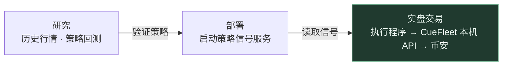

<p align="center">
  <picture>
    <source media="(prefers-color-scheme: dark)" srcset="assets/cuefleet-logo-dark.svg">
    <source media="(prefers-color-scheme: light)" srcset="assets/cuefleet-logo-light.svg">
    
  </picture>
</p>

<h1 align="center">币安事件合约策略 Skill</h1>

<p align="center">用 Codex、Claude Code 等编码智能体开发策略，回测历史表现，通过 CueFleet 本机 API 接入实盘。</p>

<p align="center">
  <a href="docs/quickstart.md#实盘接入"><strong>实盘接入</strong></a> ·
  <a href="docs/quickstart.md#模拟快速上手">示例工程</a> ·
  <a href="SKILL.md">Skill 指令</a> ·
  <a href="references/signal-project.md">信号协议</a> ·
  <a href="https://cuefleet.com/">官网</a>
</p>

## 从研究到实盘



## 跑通接入

**实盘**在客户端页眉打开「API 设置」，选择已授权的币安账号，配置单笔上限并启动本机服务。策略执行程序在同一台机器上通过本机 API 提交已确认的交易方向。使用实盘前请先阅读 [实盘接入步骤](docs/quickstart.md#实盘接入)。

**模拟**可直接用仓库提供的 BTC 示例。在安装了 Git 和 Python 3.11+ 的环境打开终端，运行下列命令。

```sh
git clone https://github.com/CueFleet/event-contract-skill.git
cd event-contract-skill
python scripts/signal_project.py --project examples --include market_momentum.py --strategy market_momentum:predict --symbol BTCUSDT --warmup 2 --name "BTC 双 K 线示例" --output my-btc-signal
```

在 CueFleet Windows 0.5.87 或以上加载 `my-btc-signal`，启动服务后预览信号。可到「本地跟单 → 我的模拟」查看执行记录。[模拟快速上手](docs/quickstart.md#模拟快速上手)

## 给编码智能体的任务示例

> 阅读 `SKILL.md`。开发 BTCUSDT 10 分钟事件合约策略，单笔按 5 USDT 回测，最多同时 5 笔。用已收盘行情划分训练和样本外区间，生成回测报告并导出信号工程。先用合成行情校验服务接口，同时整理实盘接入所需的信号和交易参数。

[MIT 许可证](LICENSE)
