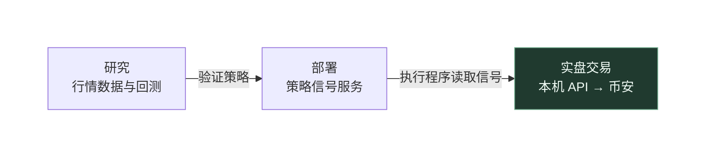

  <picture>
    <source media="(prefers-color-scheme: dark)" srcset="assets/cuefleet-logo-dark.svg">
    <source media="(prefers-color-scheme: light)" srcset="assets/cuefleet-logo-light.svg">
    
  </picture>

<h1 align="center">币安事件合约策略 Skill</h1>

面向币安事件合约的开源策略工具。用 AI 把交易思路变成可复现的研究，部署信号服务，通过 CueFleet 本机交易 API 接入实盘。

  <a href="docs/quickstart.md#实盘接入"><strong>实盘接入</strong></a> ·
  <a href="docs/btc-volume-breakout.md">真实行情案例</a> ·
  <a href="SKILL.md">Skill 指令</a> ·
  <a href="references/signal-project.md">信号协议</a> ·
  <a href="https://cuefleet.com/">官网</a>

## 从研究到实盘

## Skill 能帮你做什么

| 你带来 | Skill 帮你交付 |
| --- | --- |
| 一个交易思路 | 整理信号规则，下载 BTC 或 ETH 的公开分钟 K 线，按时间划分训练与样本外区间 |
| 一份策略代码 | 生成逐笔回放记录、样本外胜率与盈亏、最大回撤和收益三联图 |
| 一个通过研究的策略 | 导出可启动的 Python 信号服务，核对预热行情、预测方向和时间戳 |
| 一套自己的信号服务 | 按 `cuefleet.signal.v1` 验证接口，再由你的执行程序接入 CueFleet 实盘 API |

实盘接入使用已授权的币安账号。策略服务输出方向，执行程序负责校验时效、读取支付率、下单与查询原回执。[查看实盘接入步骤](docs/quickstart.md#实盘接入)

## 一次完整的策略研究

[BTC 放量突破案例](docs/btc-volume-breakout.md) 使用一个月的真实公开行情，演示如何从策略规则产出 **样本外报告、收益三联图和可启动信号服务**。历史回放与服务使用同一份策略代码，样本外结果按实记录。

## 交给你常用的 AI

将仓库交给 Codex、Claude Code 等编码工具，或把任务及相关接口说明交给 Grok、Gemini 等助手。把这句话作为开场，补上你的交易想法。

> 阅读 `SKILL.md`。我想研究 BTCUSDT 10 分钟事件合约的放量突破。用真实历史行情，按时间切分样本外区间，用同一份规则生成回测和实时信号。给我逐笔结果、收益图、可部署的信号工程，以及用 CueFleet 本机交易 API 接入实盘的配置清单。

## 联系方式

[Telegram @lazyer_trading](https://t.me/lazyer_trading) · [MIT 许可证](LICENSE)
